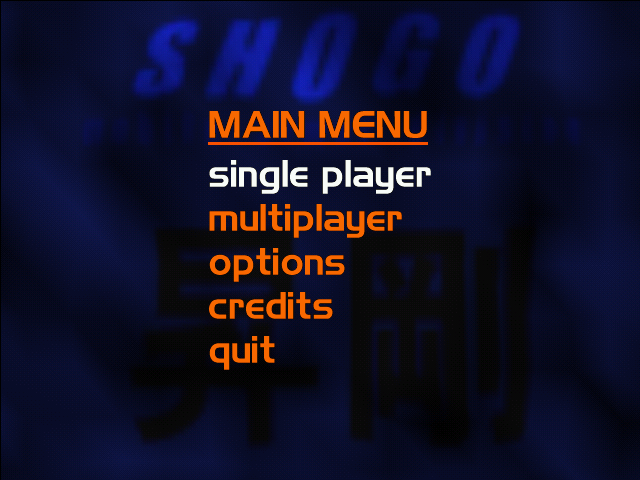
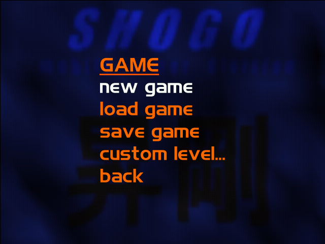
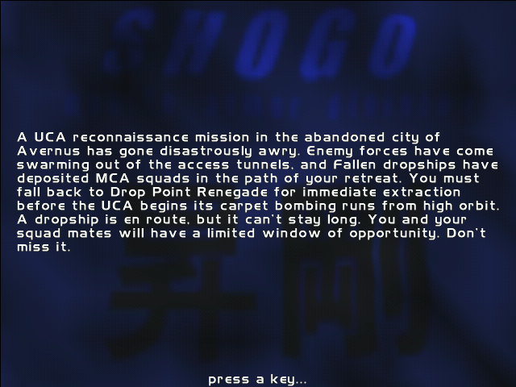

# Shogo: Mobile Armor Division — Static Recompilation

Static recompilation of **Shogo: Mobile Armor Division** (Monolith, 1998), the
first LithTech game, from its shipping Windows binaries (the 2.2 patch) to
native C. LithTech is split across modules, and every one that runs
Monolith's code (`Client.exe`, the `d3d.ren` and `soft.ren` renderers,
`server.dll`, and the game DLLs inside `SHOGOP3.REZ`) is lifted to C and
linked into one 32-bit host that calls the real DirectDraw, Direct3D,
DirectInput and Miles. No emulator, no wrapper DLLs.

Built on the [pcrecomp](https://github.com/sp00nznet/pcrecomp) toolchain, on
its **`pcrecomp-lithtech`** branch (not yet merged into `main`).

## Getting Started

You need **your own copy of Shogo**, patched to 2.2: the US CD's `Game\`
folder and `Data\SHOGO.REZ` copied into one folder, with the 2.2 patch
(`shogo_2214_full.zip`, see [docs/bringup.md](docs/bringup.md)) unzipped over
it. That folder holds `Client.exe` and `SHOGOP3.REZ`. Nothing from the game
is in this repository or downloaded for you, and no generated source: the
lifted C is made on your machine into the gitignored `src/recomp/gen/`.

### The setup script (Windows)

1. Download this repository (the green **Code** button, then **Download ZIP**)
   and unzip it somewhere with 3 GB free.
2. Double-click **`Setup.cmd`** (`-GameDir D:\Games\Shogo` skips the
   question, `-Yes` answers yes to every install).
3. Play with the **`Shogo`** shortcut in that folder.

The script asks before installing anything (Python, `pefile` and `capstone`,
Visual Studio 2022's C++ tools), clones pcrecomp on `pcrecomp-lithtech`
beside this folder if it isn't there, links your game as `game\`, and
relocates, catalogs, lifts and builds every module, in about 15 minutes. A
rerun skips finished steps; if it stops, it says why, and the details are in
`setup.log`. Building by hand and the command line are in
**[docs/building.md](docs/building.md)**.

There is no Linux or macOS build yet: `setup.sh` says so and exits.

## Status

**v0.1.0-dev, early.** A new game plays into the first mission, Ambush, in the
recompiled code.

| Stage | State |
|---|---|
| Version recompiled | Shogo 2.2 (`Client.exe` stamp `0x36DFF481`, March 1999) |
| Lift | 8 modules, 14,567 functions, 0 errors |
| Host (`build/shogo.exe`, 32-bit, `native32`) | every import bound (dry run: 0 unresolved in all 8 modules) |
| Renderer | `d3d.ren` on Direct3D's RGB software rasterizer (`+RGBRast 1`), windowed, about 13 frames a second; the hardware path is untested |
| Title, main menu, new game, difficulty | work, driven by `--key` |
| First mission (`01_Ambush`) | loads: the briefing, then in the mech with the HUD, squadmates and radio chatter |
| Playing it (moving, firing) | not tried yet |
| Sound | Miles; runs so far are muted (`+soundenable 0`) |
| Setup.cmd | tested from a fresh clone (2026-11-12): it cloned pcrecomp-lithtech, lifted, built and made the shortcut in 5 minutes; the dry run binds all 8 modules |
| Conformance harness, headless mode | not yet; the dry run is the only automatic check ([docs/testing.md](docs/testing.md)) |

[bringup.md](docs/bringup.md) is the log of each wall and its fix, and
[ROADMAP.md](ROADMAP.md) what comes next.

## Screenshots

Real output of `build\shogo.exe --run ... --shot`, recompiled code throughout:

| | |
|---|---|
|  |  |
|  |  |
|  | |

## Documentation

- [docs/building.md](docs/building.md): the setup script, step by step, the command line, build options
- [docs/testing.md](docs/testing.md): the dry run and the scripted path into Ambush
- [docs/bringup.md](docs/bringup.md): every wall so far and its fix
- [ROADMAP.md](ROADMAP.md), [CHANGELOG.md](CHANGELOG.md), [CONTRIBUTING.md](CONTRIBUTING.md)

## Contributors

See **[CONTRIBUTORS.md](CONTRIBUTORS.md)** for who did what.

## License

MIT for this repository's own code ([LICENSE](LICENSE)). Shogo and LithTech
are © Monolith Productions; none of their files, and nothing generated from
them, is in this repository ([NOTICE.md](NOTICE.md)).
