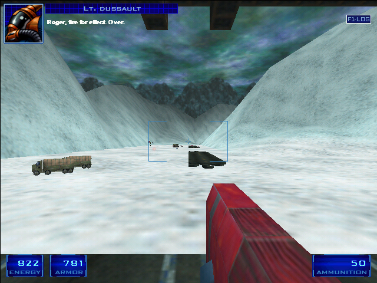

# Shogo: Mobile Armor Division — Static Recompilation


## What it is

A static recompilation of **Shogo: Mobile Armor Division** (Monolith, 1998),
the first LithTech game, from its shipping Windows binaries (the 2.2 patch) to
native C. No emulator, no wrapper DLLs.

Built on the [pcrecomp](https://github.com/sp00nznet/pcrecomp) toolchain and
following its shared house style (layout, CLI, conformance harness, headless
mode); the harness and headless mode are not here yet ([ROADMAP.md](ROADMAP.md)).

LithTech is split across modules, and every one that runs Monolith's code is
lifted to C, compiled with MSVC and linked into one 32-bit host on pcrecomp's
`native32` runtime, which calls the real DirectDraw, Direct3D, DirectInput and
Miles:

| Module | What it is | Where it comes from |
|---|---|---|
| `Client.exe` | the LithTech engine | the 2.2 patch |
| `d3d.ren`, `soft.ren` | the renderers | the 2.2 patch, the CD |
| `server.dll` | the local server | the 2.2 patch |
| `CSHELL.DLL`, `CRES.DLL` | the client game code and its resources | inside `SHOGOP3.REZ` |
| `OBJECT.LTO`, `SRES.DLL` | the server game code and its resources | inside `SHOGOP3.REZ` |

The game DLLs ship inside the `.rez` archives; the engine copies them to temp
files and `LoadLibrary`s those. The host maps every module at its own base
(they were all linked at `0x10000000`, so `tools/rebase.py` relocates them
first), and answers each `LoadLibrary` with the lifted module whose PE
timestamp matches the file named.

**Nothing from the game is in this repository, and no generated source.** You
supply your own copy; the lifted C is generated on your machine into the
gitignored `src/recomp/gen/`.

## Status: v0.1.0-dev, early. A new game plays into the first mission, Ambush, in the recompiled code.

| Stage | State |
|---|---|
| Version recompiled | Shogo 2.2 (`Client.exe` stamp `0x36DFF481`, March 1999), from the US CD + `shogo_2214_full.zip` |
| Lift | 8 modules, 14,567 functions, 0 errors |
| Host (`build/shogo.exe`, 32-bit, `native32`) | every import bound (dry run: 0 unresolved in all 8 modules) |
| Boot: rez files, the game DLLs out of `SHOGOP3.REZ`, DllMains | works |
| Renderer: `d3d.ren` on Direct3D (DX6), windowed | works on Direct3D's RGB software rasterizer (`+RGBRast 1`), about 13 frames a second. The development machine has no Direct3D HAL for DirectDraw surfaces, so the hardware path is untested |
| Title, main menu, new game, difficulty | works, driven by `--key` |
| First mission (`01_Ambush`) | loads; the briefing, then in the mech with the HUD, squadmates and radio chatter |
| Playing it (moving, firing) | not tried yet |
| Sound | Miles (`mss32.dll`); runs so far are muted (`+soundenable 0`) |
| Toolkit | needs pcrecomp's `pcrecomp-lithtech` branch (a DirectInput `HINSTANCE` shim), not yet in `main` |
| Setup.cmd, launcher | written; tested only up to the game-folder question (no game data on the test machine) |
| Conformance harness | none yet; the dry run (`build\shogo.exe`, no `--run`) is the only automatic check ([ROADMAP.md](ROADMAP.md)) |
| Headless mode (`--headless --record`) | not yet |
| netlab | recipe `shogo-recomp`, no QA step. The first farm build (clang-cl) stalled on its last three generated chunks after 45 minutes and was stopped; the local MSVC build (`build.cmd`) is the one that works |

## Screenshots

Real output of `build\shogo.exe --run ... --shot`, recompiled code throughout:

| | |
|---|---|
|  |  |
|  |  |
|  |  |

## Getting Started

You need **your own copy of Shogo**, patched to 2.2: the US CD's `Game\`
folder and `Data\SHOGO.REZ` copied into one folder, with the 2.2 patch
(`shogo_2214_full.zip`, see [docs/bringup.md](docs/bringup.md)) unzipped over
it. That folder holds `Client.exe` and `SHOGOP3.REZ`. Nothing is downloaded
for you.

### Quick start: Setup.cmd

1. Download this repository (the green **Code** button, then **Download ZIP**)
   and unzip it somewhere with 3 GB free.
2. Double-click **`Setup.cmd`**.

It checks for Python 3.10+, the `pefile` and `capstone` packages, the pcrecomp
toolkit (cloned on its `pcrecomp-lithtech` branch if missing) and the Visual
Studio 2022 C++ compiler, and **asks** before installing any of them, saying
what and how big. It looks for Shogo in the usual install folders, or asks
where it is (`Setup.cmd -GameDir D:\Games\Shogo` skips the question, `-Yes`
answers yes to every install). Then it links that folder as `game`, relocates
the modules, finds every function, recompiles them and builds
`build\shogo.exe`. A rerun skips the finished steps. If it stops, it says why
in one sentence, and the details are in `setup.log`.

It ends with a **`Shogo`** shortcut in the folder
(`build\shogo.exe --run -- +windowed 1 +RGBRast 1`). Double-click it to play.

### Step by step

Prerequisites: Windows 10/11, **Python 3.10+** (`py -3 --version`), **git**,
**Visual Studio 2022** (or its Build Tools) with *Desktop development with
C++*, and pcrecomp cloned **beside** this repository as `pcrecomp`, on the
`pcrecomp-lithtech` branch:

```
some-folder\
  pcrecomp\        <- git clone -b pcrecomp-lithtech https://github.com/sp00nznet/pcrecomp
  shogo\           <- this repository
```

1. Python packages:
   ```
   py -3 -m pip install --user pefile capstone
   ```
2. Point `game` at your 2.2 folder:
   ```
   mklink /J game D:\Games\Shogo
   ```
3. Relocate the modules (the game DLLs come out of `SHOGOP3.REZ`):
   ```
   py -3 tools\rebase.py
   ```
   Expected, at the end: `soft.ren     0x10700000-0x1076b000`.
4. The function catalog, all 8 modules in parallel:
   ```
   py -3 tools\catalog.py
   ```
   Each module's log is `work\<module>.catalog.log`; `Client.exe`'s ends
   `[*] Functions: 3335  (thunks=5, leaves=935)`.
5. Recompile to C, then build (MSVC's 64-bit-hosted x86 compiler, CMake and
   Ninja; all three come with the C++ workload):
   ```
   py -3 run_lift.py
   build.cmd
   ```
6. Check it without opening a window:
   ```
   build\shogo.exe
   ```
   Expected: eight `[bind] ... 0 unresolved` lines, then
   `(dry run: mapped and bound; --run enters 0x00467ED0)`.
7. Play: `build\shogo.exe --run -- +windowed 1 +RGBRast 1`.

The usual trip-ups: `python` opening the Microsoft Store (Windows' alias
placeholder; use `py -3`, or turn the alias off in *Settings > Apps > Advanced
app settings > App execution aliases*); a freshly installed Python not on
`PATH` until you open a new window; and a pcrecomp on `main` instead of
`pcrecomp-lithtech` (DirectInput then fails and the engine quits at once).

## Usage

```
build\shogo.exe --run -- +windowed 1 +RGBRast 1 +soundenable 0
build\shogo.exe --run --key 0x20@25 --key 0x0D@35 --key 0x0D@45 --key 0x0D@55 ^
    --key 0x0D@65 --key 0x0D@80 --key 0x20@115 --shot 130 ambush.bmp ^
    -- +windowed 1 +RGBRast 1 +soundenable 0
```

The second line is the scripted path into the first mission: Space, Enter five
times (single player, new game, normal, past the two intro captions), Space
past the briefing.

| Flag | |
|---|---|
| `--run` | enter the game (without it: map, bind and stop) |
| `--game DIR` | the game folder (default `game`) |
| `--rebased DIR` | the relocated modules (default `work\rebased`) |
| `--key VK@S` | press a virtual key S seconds in (DirectInput and `WM_KEYDOWN`) |
| `--shot S FILE.bmp` | save the renderer's back buffer at S seconds (up to 8) |
| `--watchdog S` | stop after S seconds and say where every thread was |
| `--trace-at S` | one second of the native-call trace at S seconds |
| `--native-trace`, `--callbacks` | one line per call into Windows, or back from it |
| `--no-16bit` | skip the relaunch under the `16BITCOLOR` compatibility layer |
| `-- ...` | everything after goes to the engine as console variables |

The host runs itself again under Windows' "reduced color mode" compatibility
layer: the renderers only draw 16-bit surfaces, and in a window they take the
desktop's format.

## Building from source

Steps 3 to 5 above. `PCRECOMP` (Python) and `-DPCRECOMP=` (CMake, through
`set CMAKE_ARGS=...` for `build.cmd`) point at a toolkit checkout other than
`..\pcrecomp`; the lifter and the runtime must come from the same tree.
On the farm: `netlab build shogo-recomp`. What the game needed, in the order it
turned up, is [docs/bringup.md](docs/bringup.md).

## Credits

The loader came from the [Unreal Tournament recomp](https://github.com/sp00nznet/ut99-recomp),
the layout from the [Crazy Taxi recomp](https://github.com/sp00nznet/crazytaxi-recomp),
on [pcrecomp](https://github.com/sp00nznet/pcrecomp)'s `native32` runtime.
See [NOTICE](NOTICE).

## License

MIT, for the code in this repository ([LICENSE](LICENSE); attributions in
[NOTICE](NOTICE)). Shogo and LithTech are © Monolith Productions; none of it
is here.
