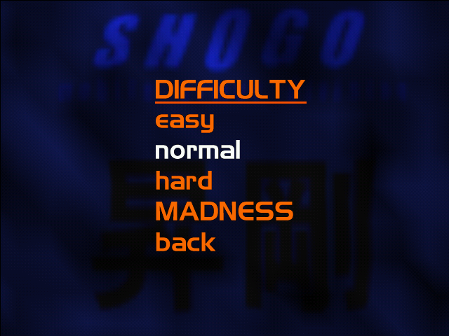
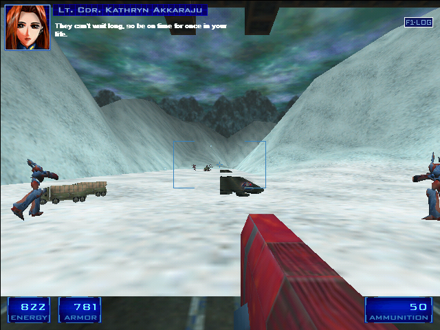

<div align="center">

# Shogo: Mobile Armor Division, recompiled

**Shogo: Mobile Armor Division** (Monolith, 1998), the first LithTech game,
taken apart from its shipping Windows binaries and rebuilt as a native
program. No emulator, no wrapper DLLs.


</div>

## What it is

A static recompilation of Shogo 2.2 (the last official patch). LithTech is
split across modules, and every one that runs Monolith's code is lifted to C
by [pcrecomp](https://github.com/sp00nznet/pcrecomp), compiled with MSVC and
linked into one 32-bit host on pcrecomp's `native32` runtime, which calls the
real DirectDraw, Direct3D, DirectInput and Miles:

| Module | What it is | Where it comes from |
|---|---|---|
| `Client.exe` | the LithTech engine | the 2.2 patch |
| `d3d.ren`, `soft.ren` | the renderers | the 2.2 patch, the CD |
| `server.dll` | the local server | the 2.2 patch |
| `CSHELL.DLL`, `CRES.DLL` | the client game code and its resources | inside `SHOGOP3.REZ` |
| `OBJECT.LTO`, `SRES.DLL` | the server game code and its resources | inside `SHOGOP3.REZ` |

The game DLLs ship inside the `.rez` archives; the engine copies them to temp
files and `LoadLibrary`s those. The host maps every module at its own base
(they were all linked at `0x10000000`, so `tools/rebase.py` relocates them
first), and answers each `LoadLibrary` with the lifted module whose PE
timestamp matches the file named.

**Generated source is not distributed.** You supply your own copy of the game,
and the lifted C is generated on your machine. Nothing from the game is in this
repository.

## Status: early. A new game plays into the first mission, Ambush, in the recompiled code.

| | |
|---|---|
| Version recompiled | Shogo 2.2 (`Client.exe` stamp `0x36DFF481`, March 1999), from the US CD + `shogo_2214_full.zip` |
| Lift | 8 modules, 14,567 functions, 0 errors |
| Boot: rez files, the game DLLs out of `SHOGOP3.REZ`, DllMains | ✅ |
| Renderer: `d3d.ren` on Direct3D (DX6), windowed | ✅ on Direct3D's RGB software rasteriser (`+RGBRast 1`), about 13 frames a second. This machine has no Direct3D HAL for DirectDraw surfaces, so the hardware path is untested |
| Title, main menu, new game, difficulty | ✅ driven by `--key` |
| First mission (`01_Ambush`) | ✅ loads; the briefing, then in the mech with the HUD, squadmates and radio chatter |
| Playing it (moving, firing) | not tried yet |
| Sound | Miles (`mss32.dll`); runs are muted (`+soundenable 0`) |
| Setup script, launcher, netlab | not yet |

| | |
|---|---|
|  |  |
|  |  |

## Getting started

You need Windows 10/11, Python 3 with `capstone` and `pefile`, Visual Studio
2022 with the C++ x86 tools, and a checkout of
[pcrecomp](https://github.com/sp00nznet/pcrecomp) next to this one (or set
`PCRECOMP` and `-DPCRECOMP=...`; this needs the `pcrecomp-lithtech` branch
until it is merged).

1. Install the game: copy the CD's `Game\` folder and `Data\SHOGO.REZ` into
   one folder, unzip the 2.2 patch (`shogo_2214_full.zip`) over it, and make
   `game` point at it (`mklink /J game <folder>`).
2. Relocate, catalogue and lift:
   ```
   py -3 tools\rebase.py
   py -3 tools\catalog.py
   py -3 run_lift.py
   ```
3. Build: `build.cmd`.
4. Run: `build\shogo.exe --run -- +windowed 1 +RGBRast 1 +soundenable 0`.
   The scripted path into the first mission (`--shot` writes the frames):
   ```
   build\shogo.exe --run --key 0x20@25 --key 0x0D@35 --key 0x0D@45 --key 0x0D@55
       --key 0x0D@65 --key 0x0D@80 --key 0x20@115 --shot 130 ambush.bmp
       -- +windowed 1 +RGBRast 1 +soundenable 0
   ```

Everything after `--` goes to the engine as console variables. Host options:
`--watchdog S`, `--shot S FILE.bmp` (the renderer's back buffer, more than one
is fine), `--key VK@S`, `--trace-at S` (one second of the native-call trace),
`--native-trace`, `--callbacks`, `--no-16bit`.

The host runs itself again under Windows' "reduced color mode" compatibility
layer (`16BITCOLOR`): the renderers only draw 16-bit surfaces, and in a window
they take the desktop's format. `--no-16bit` skips it.

## How it works

[docs/bringup.md](docs/bringup.md) is what this game needed, in the order it
turned up.

## Credits

The loader came from the [Unreal Tournament recomp](https://github.com/sp00nznet/ut99-recomp),
the layout from the [Crazy Taxi recomp](https://github.com/sp00nznet/crazytaxi-recomp),
on [pcrecomp](https://github.com/sp00nznet/pcrecomp)'s `native32` runtime.
See [NOTICE](NOTICE).

## License

MIT for the code in this repository; see [LICENSE](LICENSE). Shogo and
LithTech are (c) Monolith Productions and are not included.
